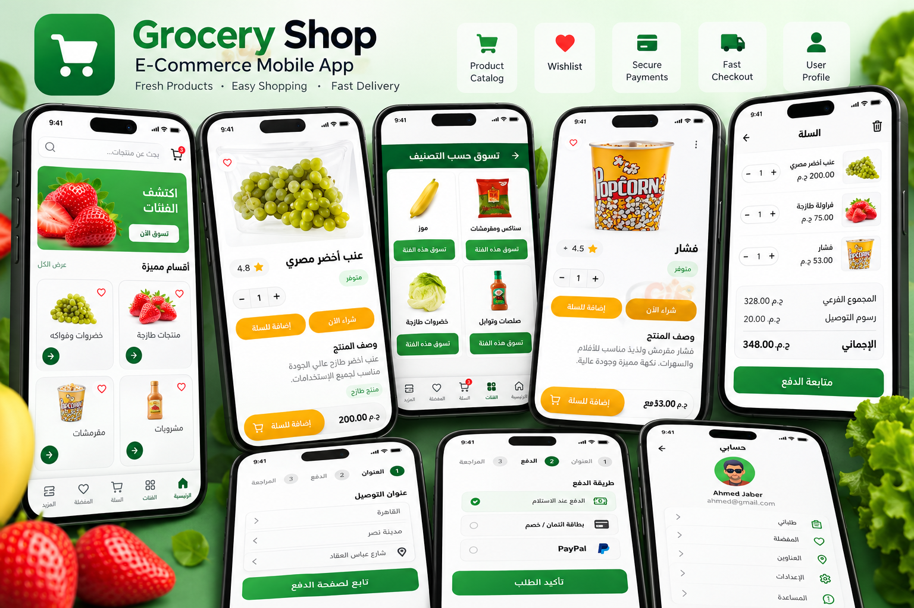
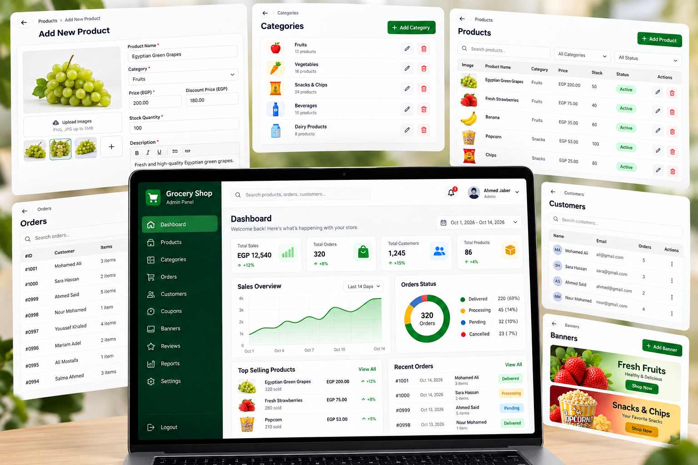

<div align="center">

# 🛍️ E-Commerce App & Admin Dashboard

### Flutter • Firebase • BLoC/Provider • Stripe • PayPal

A modern e-commerce application built with **Flutter and Firebase**, featuring a customer shopping experience, product management, shopping cart, wishlist, online payments, and an admin dashboard.


</div>

---

## 📸 Project Preview


<h2 align="center">📸 Project Preview</h2>

<div align="center">

  <h3>🛍️ E-Commerce App & Admin Dashboard</h3>

  

  <br><br>

  <h3>📱 Additional App Screens</h3>

  

</div>


---

## 📖 About the Project

**E-Commerce App & Admin Dashboard** is a Flutter-based shopping and store management system.

The project combines a customer-facing shopping application with an administrative dashboard to manage store operations.

It uses Firebase for backend services and integrates Stripe and PayPal for payment functionality.

### Customer Application

Customers can browse products, explore categories, manage their shopping cart, save favorite items, and proceed through the checkout process.

### Admin Dashboard

Administrators can manage product listings, organize categories, and oversee store information through a dedicated interface.

---

## ✨ Key Features

### 🛍️ Product Catalog

- Browse available products.
- View product details and images.
- Explore product categories.
- View product prices.
- Search and discover products.

### 🛒 Shopping Cart

- Add products to the shopping cart.
- Manage selected items.
- Update product quantities.
- Remove products from the cart.
- Review the order total.

### ❤️ Wishlist

- Save favorite products.
- View saved items.
- Remove items from favorites.
- Manage wishlist selections.

### 🔐 Authentication

- User registration and login.
- Firebase Authentication integration.
- User session management.
- Account-related functionality.

### 💳 Payment Integration

- Stripe payment integration.
- PayPal payment integration.
- Checkout and payment workflows.

### 🛠️ Admin Dashboard

- Add new products.
- Edit existing products.
- Delete products.
- Manage product categories.
- Manage product information.
- Admin-focused interface.

### 🎨 User Experience

- Modern Flutter UI.
- Responsive layouts.
- Reusable widgets.
- Clean navigation.
- Organized product cards.
- Consistent design components.

---

## 🛠️ Technologies Used

| Technology | Purpose |
|------------|---------|
| Flutter | Cross-platform UI |
| Dart | Application logic |
| Firebase | Backend services |
| Cloud Firestore | Product and store data |
| Firebase Authentication | User authentication |
| Firebase Storage | Product images, if configured |
| BLoC / Provider | State management |
| Stripe | Online payments |
| PayPal | Online payments |
| Git & GitHub | Version control |

---

## 🏗️ System Architecture

The project connects the customer application and administrative dashboard to a shared Firebase backend.

```text
         E-Commerce System
                 |
        +--------+--------+
        |                 |
        v                 v
   Customer App      Admin Dashboard
        |                 |
        +--------+--------+
                 |
                 v
          Firebase Backend
                 |
       +---------+---------+
       |         |         |
       v         v         v
      Auth    Firestore   Storage
                 |
                 v
        Products / Categories
        Users / Orders / Cart
                 |
                 v
           Payment Services
             /       \
            v         v
         Stripe     PayPal
```

This diagram illustrates the intended high-level structure; the exact data flow depends on the implementation.

---

## 🔄 Shopping Workflow

```text
       Open Application
                |
                v
          Browse Products
                |
                v
         Select Product
                |
                v
        View Product Details
                |
                v
           Add to Cart
                |
                v
           Review Cart
                |
                v
             Checkout
                |
                v
          Select Payment
                |
         +------+------+
         |             |
         v             v
       Stripe        PayPal
                |
                v
          Order Processing
```

---

## 👥 User Roles

### Customer

- Browse products and categories.
- View product information.
- Add items to cart.
- Save favorite products.
- Complete supported checkout flows.

### Administrator

- Manage store products.
- Create and update listings.
- Delete products.
- Organize product categories.
- Maintain store catalog information.

---

## 📂 Project Structure

A possible Flutter project organization is:

```text
ecommerce_app/
|
├── lib/
│   ├── core/
│   ├── models/
│   ├── screens/
│   ├── widgets/
│   ├── services/
│   ├── state_management/
│   └── main.dart
|
├── assets/
├── android/
├── ios/
├── web/
├── pubspec.yaml
└── README.md
```

Adapt this structure to match the actual repository.

---

## 🚀 Getting Started

### Prerequisites

Make sure you have:

- Flutter SDK
- Dart SDK
- Android Studio or VS Code
- Git
- Firebase project
- Stripe developer account
- PayPal developer account

### 1. Clone the Repository

```bash
git clone <YOUR_ECOMMERCE_REPOSITORY_URL>
```

Replace the placeholder with your actual GitHub repository URL.

### 2. Open the Project

```bash
cd <YOUR_PROJECT_FOLDER>
```

### 3. Install Dependencies

```bash
flutter pub get
```

### 4. Configure Firebase

Create a Firebase project:

https://console.firebase.google.com/

Configure the Firebase services required by your project, such as:

- Firebase Authentication.
- Cloud Firestore.
- Firebase Storage.
- Firebase Security Rules.

If the application uses FlutterFire CLI, configure it with:

```bash
dart pub global activate flutterfire_cli
flutterfire configure
```

Ensure the generated Firebase configuration matches your application's initialization code.

### 5. Configure Payment Services

Configure Stripe and PayPal according to the integrations implemented in the project.

Use test-mode credentials during development.

**Security:** Keep Stripe secret keys, PayPal client secrets, and payment verification logic on a secure backend. Never embed private payment credentials in the Flutter application.

### 6. Run the Application

```bash
flutter run
```

The project requires its corresponding Firebase configuration, database structure, and payment services to function correctly.

---

## 🔒 Security Considerations

- Protect user data with Firebase Security Rules.
- Restrict administrative operations to authorized users.
- Validate product prices and orders on a trusted backend.
- Verify payment results server-side.
- Avoid storing sensitive credentials in the repository.
- Use secure authentication and authorization.

---

## 💡 Development Highlights

This project demonstrates experience in:

- Flutter mobile application development.
- Building e-commerce user interfaces.
- Firebase backend integration.
- Product and category management.
- Shopping cart and wishlist functionality.
- BLoC and Provider state management.
- Payment service integration.
- Customer and administrator workflows.
- Responsive application design.

---

## 🎯 Project Goals

- Deliver an intuitive shopping experience.
- Create a manageable product catalog.
- Support cart and wishlist interactions.
- Provide administrative tools for store management.
- Integrate online payment services.
- Build reusable Flutter components.

---

## 🔮 Potential Future Improvements

- Order tracking and delivery status.
- Push notifications.
- Product reviews and ratings.
- Discount codes and promotions.
- Advanced analytics.
- Inventory management.
- Product recommendations.
- Multi-language support.

---

## 👨‍💻 Developer

**Ahmed Jaber Ahmed**

Flutter Developer | Mobile App Developer

B.Sc. Computer Science & Artificial Intelligence

📍 Cairo, Egypt

- [GitHub](https://github.com/AhmedJaberAhmed)
- [Portfolio](https://ahmedjaberahmed.github.io/Jaber-website/)
- [LinkedIn](https://www.linkedin.com/in/ahmedjaberahmed/)

---

<div align="center">

### ⭐ Support the Project

If you find this project interesting, consider giving it a star!

**Built with Flutter 💙 and Firebase 🔥**

</div>
